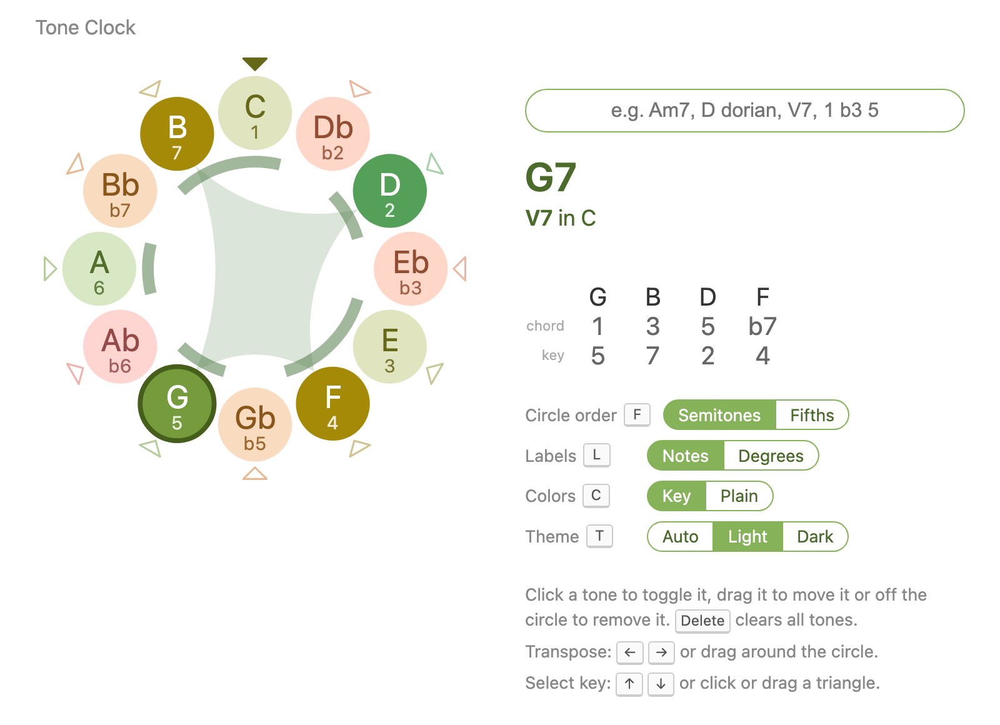

# Tone Clock

An interactive tool for exploring chords, scales and keys: the 12 tones of
the octave are arranged around a circle like the hours on a clock. What tone
o'clock is it?

**Try it: [bzamecnik.github.io/tone-clock](https://bzamecnik.github.io/tone-clock/)**:
it runs in the browser and can be installed as an app that works offline.



## What it does

- **Pick tones** on the circle and see what they are called: a chord (`Am7`),
  a scale (`C diatonic (major)`) or just a set of notes.
- **Type** a chord, scale or notes (`F#m7b5`, `D dorian`, `C E G`) to show
  them on the circle.
- **Choose a key** to see chords as Roman numerals (`IVm7 in A`) and tones
  as scale degrees (`1 b3 5`). Then you can also type `V7` or `1 b3 5`.
- **Transpose** by turning the circle: shapes stay the same, only the names
  change. A major chord looks the same from every root.
- **Switch to the circle of fifths**, where a major scale is a single arc of
  7 neighboring tones.
- **Color by key**: tones of the key are green, the tritone yellow and the
  tones outside the key red.
- **Share a link**: the address always links to the current tones and key,
  e.g. [`#tones=G,B,D,F&key=C`](https://bzamecnik.github.io/tone-clock/#tones=G,B,D,F&key=C).
- Light and dark theme.

## Controls

| To | Mouse / touch | Keyboard |
| --- | --- | --- |
| add or remove a tone | click a bead | Tab to it, then Enter or Space |
| move a tone | drag it onto another bead | |
| remove a tone | drag it off the circle | |
| type a chord, scale or notes | click the text field | / |
| clear all tones | | Delete |
| transpose | drag around the circle (off the beads) | ← → |
| choose a key | click or drag a triangle outside the circle | ↑ ↓ |
| circle of fifths | Circle order toggle | F |
| note names / degrees on the beads | Labels toggle | L |
| key colors / plain | Colors toggle | C |
| theme | Theme toggle | T |
| show all controls | Controls link | ? |

The music theory behind the features (why a clock, the circle of fifths, key
colors, how tones are named) is explained in
[docs/music-theory.md](docs/music-theory.md).

## History

Tone Clock is a re-creation of the Android app *Tone Circle* (2013),
originally written in Java, now as a React web app with many new features.


## Development

Requirements: Node.js 20+.

```sh
npm install
npm run dev            # start the dev server at http://localhost:5173
npm test               # run unit tests (Vitest) in watch mode
npm run lint           # lint (oxlint)
npm run build          # type-check and build for production into dist/
npm run preview        # serve the production build locally
```

Each push to `main` is tested and deployed on GitHub Pages
(`.github/workflows/`); pull requests and other branches are tested.

### Project layout

- `src/music/` — pure, UI-independent music theory model (pitch class sets,
  names, keys)
- `src/components/ToneClock/` — the tone clock React component
- `src/components/ChordInput/` — text input parsing chord/scale names
- `docs/plan.md` — implementation plan and roadmap

## Credits

- Ideas and guidance: Bohumír Zámečník
- Most of the implementation: Claude Code (Opus 5.5)

## License

[MIT](LICENSE)
